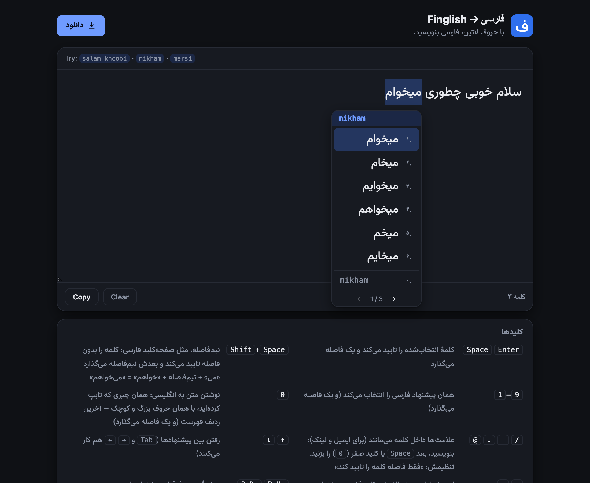

# Finglish → فارسی

**Type Persian with English letters — a free Finglish / Pinglish to Persian converter and keyboard.** Write `salam khoobi`, get سلام خوبی — pick from a list of candidates and keep going.
A website to try it, and a macOS keyboard to use it in every app. Both run the same offline engine: nothing you type ever leaves your computer.

**Website: [finglish.mehrashojjat.com](https://finglish.mehrashojjat.com)** · **Source: [github.com/mehrashojjat/Finglish](https://github.com/mehrashojjat/Finglish)** · by [Mehras Hojjat](https://mehrashojjat.com)



* **Offline and private.** No server, no account, no tracking. The page and the keyboard contain no network code at all — checked by tests (see [Privacy](#privacy-offline-and-proven)).
* **One engine everywhere.** `engine/dist/` is the single shipped artifact; the website and the Mac keyboard run exactly the same code and data (≈ 2 ms per keystroke).
* **Understands how people really type.** `slm`, `salaam`, `khoobi`/`khobi`, `merci`/`mersi`, `mikham`, `ketabhayeman` → the right word, for colloquial and formal Persian.
* **Free and open source** under the GNU AGPL-3.0 ([Licence](#licence)).
* **In Persian and English:** the site has a Persian page (`/`) and an English page (`/en/`), set up to be found by search engines and AI assistants ([`docs/SEO.md`](docs/SEO.md)).

## Download

| | |
|---|---|
| **macOS** 26 or newer, Apple silicon and Intel (4.8 MB, signed and notarized by Apple) | [`downloads/Finglish.dmg`](downloads/Finglish.dmg) — or the **دانلود** button on [the website](https://finglish.mehrashojjat.com) |
| **Windows** | coming soon |

Open the image, drag **Finglish Settings** onto **Applications**, open it. The first launch installs the keyboard and shows a four-step guide for the one thing macOS makes you do yourself: add the keyboard under *System Settings → Keyboard → Text Input → Input Sources*.
The app is signed with a Developer ID and notarized by Apple, so it opens without a warning. Details: [`mac/README.md`](mac/README.md).

## Try the website

```bash
npm start          # rebuilds the web data, serves http://localhost:8080 and opens your browser (Ctrl-C to stop)
```

* It listens on `127.0.0.1` only and uses the next free port if 8080 is busy. `npm run serve` does the same without opening a browser.
* No server is needed either: open `index.html` straight from disk. Node.js is only needed for `npm` scripts and tests.

**By hand (two minutes).** Type `salam` → a list appears under the word; **Space** commits `سلام ` and adds a space. Try `slm`, `khoobi`, `mersi`, `mikham`, `ketabhayeman`, `whatsapp`.

| key | does |
|---|---|
| `Space` `Enter` | commit the highlighted word and add a space |
| `1`–`9` | pick that Persian candidate |
| `0` | keep the English **exactly as typed** (the last row of the list) |
| `Shift`+`Space` | half-space (نیم‌فاصله), as on a Persian keyboard: `mi` ⇧Space `khaham` → می‌خواهم |
| `↓` `↑` `Tab` · `PgDn` `PgUp` | move through the candidates · next / previous page |
| `Esc` · `⌫` · `⌘Z` | cancel the word · delete a letter · undo a word |
| `, ; ?` and digits | become ، ؛ ؟ and ۱۲۳; signs like `@ . - /` stay inside the word so e-mails and links can be typed |

A lone key lists its own letters first (`s` → س ص ث ش) and every list ends with the letter-by-letter spelling, so a word that is in no list can always be typed. The Persian page is right-to-left; the English page is a full English version of the same tool.

## How good is it?

Measured on hand-written benchmarks of colloquial Finglish (`tests/gold/`, full table and method in [`docs/RESULTS.md`](docs/RESULTS.md)):

| benchmark | n | top-1 | top-5 |
|---|---:|---:|---:|
| natural Finglish (parameters tuned on 80 % of it) | 630 | 95.9 % | 100 % |
| **held-out** set, written after tuning was frozen | 267 | 91.8 % | 98.5 % |
| inflected forms (plurals, possessives…) | 111 | 92.8 % | 100 % |

Speed: median 2.4 ms and p95 6.8 ms per query, start-up 0.5 s, ≈ 100 MB. These are my own benchmarks, not a universal accuracy claim; real-world accuracy will differ.
Honest limits: brand-new slang and brands need an alias or learning; typos are not corrected; ambiguity cannot be removed without meaning (`sher` is شعر, شر and شهر), hence candidates, context and learning.

## How it works

A classic **noisy-channel** model: the typed Latin is aligned against Persian words (a letter-by-letter cost table of how people spell Persian sounds) and weighted by how common the word is.
Candidates come from a **skeleton index** (a hash lookup whatever vowels were typed), unseen words from a character model, unseen inflections from a small morphology, and the previous word and your own choices re-rank them.
Everything is in [`engine/src/`](engine/src) (≈ 1,000 lines, no dependencies); [`docs/ENGINE.md`](docs/ENGINE.md) explains it in detail and [`docs/ARCHITECTURE.md`](docs/ARCHITECTURE.md) shows how the pieces fit.

## Repository layout

The repository root **is** the website, so any static host can publish it as it stands.

```
index.html     the website (Persian)           downloads/   Finglish.dmg — what the download button serves
en/index.html  the website (English)           engine/      the offline engine (src/ and the one-file dist/ package)
assets/        css · js · fonts · logo · images · generated data (assets/data, assets/vendor)
robots.txt · llms.txt · sitemap.xml · 404.html · favicon.ico · apple-touch-icon.png   for search engines and AI assistants
mac/           the macOS keyboard + settings app, DMG scripts      data/   word lists: aliases, lexicon, bigrams
docs/          ARCHITECTURE · ENGINE · DATA_SOURCES · RESULTS · TUNING · SEO
tools/         build, bundle, serve and tuning scripts             tests/  unit, site and browser tests · gold sets · parity vectors
LICENSE        GNU AGPL-3.0
```

## Development

```bash
npm test               # engine tests + repository checks (≈ 10 s)
npm run e2e            # browser tests of the website — needs Google Chrome installed (offline)
npm run check          # both
npm run proof          # the two guarantees: no network use (proof:offline), identical answers in Node, Chrome and macOS (proof:mac)
npm run eval           # accuracy on the gold sets          npm run report   # regenerate docs/RESULTS.md
npm run cli -- --explain --max 5 salam mikham      # try the engine in the terminal
npm run seo -- <address>   # write the files that need the published address (canonical, sitemap…) — see docs/SEO.md
npm run bundle         # rebuild engine/dist and assets/{vendor,data} after changing engine/ or data/   (npm start does it for you)
npm run parity         # regenerate tests/golden/parity_vectors.jsonl after an intentional engine change (review with git diff)
npm run mac:test       # the Mac keyboard's tests (needs Xcode)       npm run mac:install   # install it for yourself
npm run mac:release    # build the DMG and publish it to downloads/ (see mac/README.md)
```

Browser tests default to the file on disk; to test the served site: `APP_URL=http://localhost:8080/ npm run e2e` while `npm run serve` is running.
Rebuilding the word list from the raw corpora: [`docs/DATA_SOURCES.md`](docs/DATA_SOURCES.md). The Mac keyboard: [`mac/README.md`](mac/README.md).

## Publishing the website

Publish the repository root with any static host. The live site, **https://finglish.mehrashojjat.com**, is served by Cloudflare Pages straight from this repository's `main` branch: framework preset *None*, no build command, build output directory left empty (the repository root). Nothing is built on deploy, because the bundled engine and word lists are committed. (GitHub Pages works too: *Settings → Pages → Deploy from a branch → `main` / `(root)`*; the empty `.nojekyll` file keeps it from processing the files.)
The address-dependent files (canonical and hreflang links, sitemap, structured-data URLs) were written with `npm run seo -- https://finglish.mehrashojjat.com/`; for a different address run it again, and follow the checklist in [`docs/SEO.md`](docs/SEO.md).
Every link on the page is relative, so it works at `/` and under a project path such as `/finglish/`. The download button links to `downloads/Finglish.dmg` with the HTML `download` attribute, so the browser saves the file instead of opening another page.
To ship a new Mac version: bump `VERSION` in `mac/build.sh` and `version` in `package.json`, run `npm run mac:release`, run `npm test`, commit the new `downloads/Finglish.dmg`.

## Privacy: offline, and proven

`npm run proof:offline` checks that the website makes no network request of any kind, three independent ways: a static audit (no `fetch`, `XMLHttpRequest`, `WebSocket`… anywhere, nothing external loaded), Node with every network route blocked, and real Chrome with its network switched off — each with a positive control so "zero" means something.
The download is the one deliberate exception: the file is requested only when you click its link. The Mac apps contain no network code and link no network framework. Settings, text and learned choices stay in your browser or on your Mac.

## Licence

* **Program code** — [GNU Affero General Public License v3.0 only](LICENSE) (`AGPL-3.0-only`), © 2026 Mehras Hojjat. You may use, study, modify and share it, and sell it too, as long as you release your version — including the source of a modified version offered as a network service — under the same licence.
  The complete source of the website, the engine and the Mac keyboard is this repository, [github.com/mehrashojjat/Finglish](https://github.com/mehrashojjat/Finglish); the website and the Mac app both link to it, and the disk image on the website is built from it (`mac/make_dmg.sh`).
  If you want to use it in a product you do not want to release under the AGPL, that needs a separate agreement with the author: [mehrashojjat.com](https://mehrashojjat.com).
* **Word lists** (`data/build/`, their copies in `engine/dist/` and `assets/data/`) — derived from Persian Wikipedia, Wiktionary and OpenSubtitles word counts, so they stay under **CC BY-SA 4.0** with credit to those sources ([`docs/DATA_SOURCES.md`](docs/DATA_SOURCES.md)).
* **Vazirmatn font** — SIL Open Font License 1.1 ([`assets/fonts/OFL.txt`](assets/fonts/OFL.txt)).

## Credits

Made by [Mehras Hojjat](https://mehrashojjat.com). Data: [OpenSubtitles](https://www.opensubtitles.org) (via OPUS), [Persian Wikipedia](https://fa.wikipedia.org), [Wiktionary](https://fa.wiktionary.org) (via kaikki.org). Font: [Vazirmatn](https://github.com/rastikerdar/vazirmatn) by Saber Rastikerdar. The Apple logo glyph in the download dialog is from [Simple Icons](https://simpleicons.org) (CC0); Apple and Windows are trademarks of their owners.
